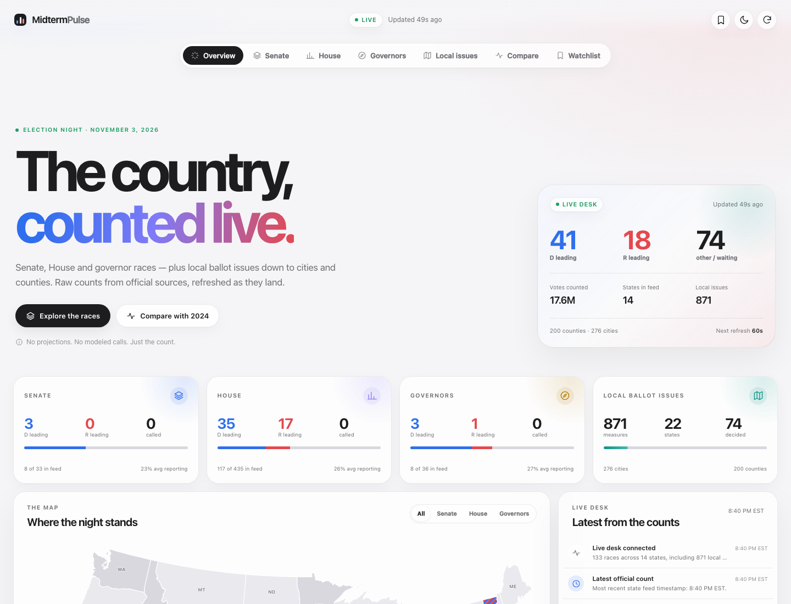
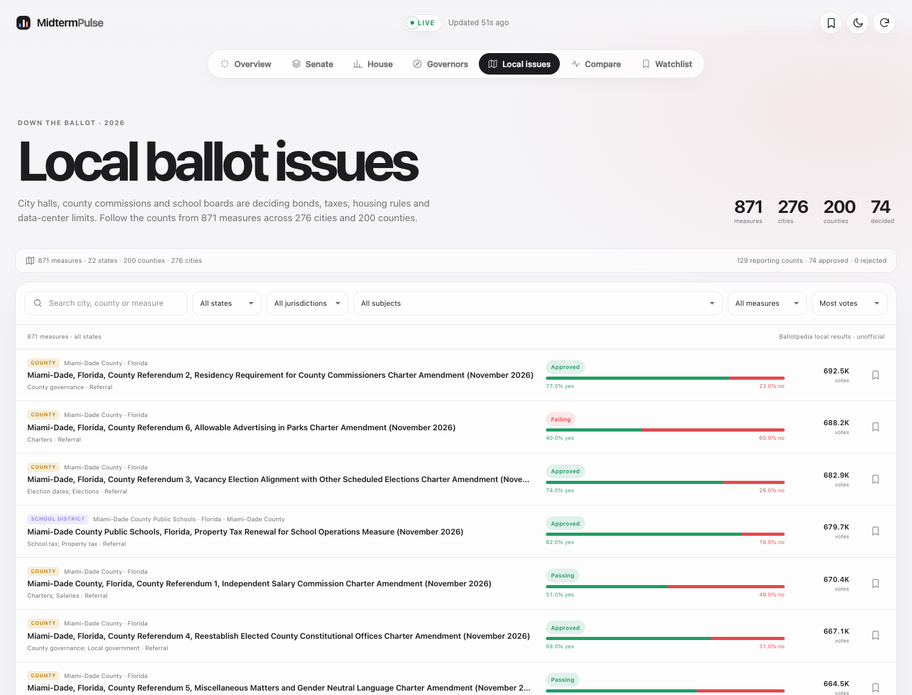
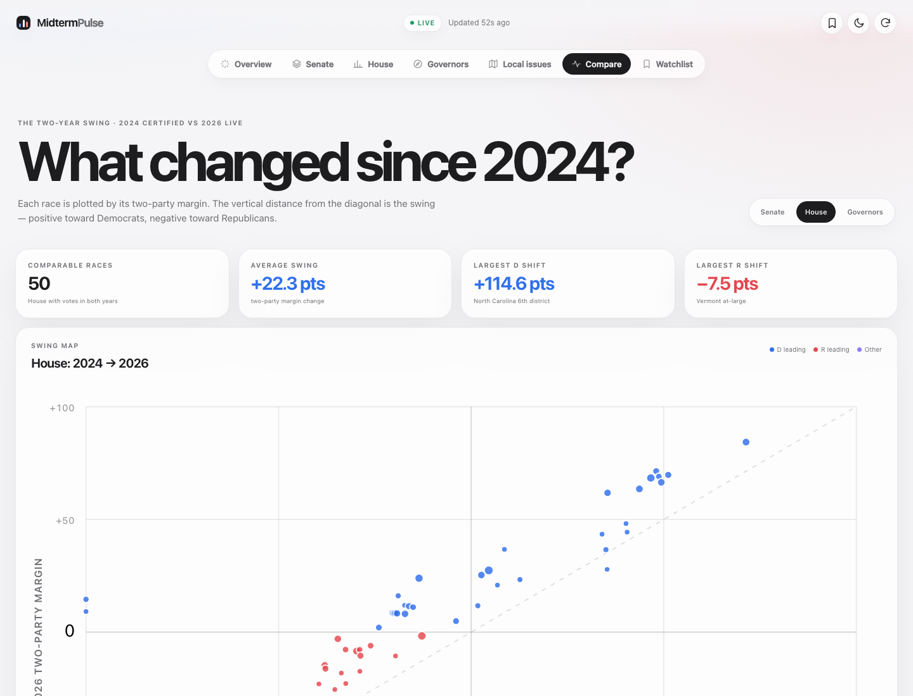

# Midterm Pulse

[](https://github.com/michaelheavener4/midterm-pulse/actions/workflows/deploy.yml)

[**Open the live site →**](https://michaelheavener4.github.io/midterm-pulse/)

A live, nonpartisan dashboard for the 2026 US midterms. It tracks Senate, House and governor races from official state election feeds, compares the two-party margin with the 2024 certified results, and follows local ballot issues down to cities and counties.



## What it does

- **Live federal and statewide races** — Senate, House and governor results merge multiple official state feeds and refresh every 60 seconds.
- **2024 comparison** — a scatter plot, ranked swing table and per-race comparison show how the two-party margin has moved since the last certified election.
- **Local ballot issues** — 871 measures across 22 states, 200 counties and 276 cities, with city, county, school district and township filters.
- **Interactive US map** — click any state to open its races and local measures.
- **Watchlist** — bookmark races and local measures; saved locally in your browser.
- **Closest races and a live desk** — lead changes and new reporting milestones as they land.
- **Light and dark appearance** — follows the system theme, with a manual toggle.

| Local issues | 2024 comparison |
| --- | --- |
|  |  |

## Run it

```bash
npm install
npm run dev
```

Build for a static host:

```bash
npm run build
npm run preview
```

The app is a static Vite site. It needs no API keys and has no backend. Pushes to `main` deploy automatically to GitHub Pages.

## Data

- **Federal and state race counts:** [OpenAmerica election results](https://openamerica.io/elections/api/) and [Pushbuild's live election feeds](https://api.pushbuild.com/portal/elections/live/index.json). Both republish official state and county election sources. Each race is matched across feeds and shown with the most complete raw count available; the race drawer lists every contributing source. Counts are raw and unofficial until certified.
- **Local ballot measures:** [Ballotpedia's 2026 local ballot measure coverage](https://ballotpedia.org/Local_ballot_measure_elections_in_2026). The committed local index is a snapshot used as a resilient fallback.
- **2024 baseline:** the certified 2024 replay from OpenAmerica.
- **Map geometry:** US states from [us-atlas](https://github.com/topojson/us-atlas), rendered with d3-geo.

Refresh the local measure index:

```bash
npm run local
```

This fetches Ballotpedia state pages and regenerates `src/local-issues.json`. The file can be large, so it is committed to keep the site deployable without a server.

## Notes and limits

- Midterm Pulse does not project winners or call races. It displays raw counts and leads reported by the source feeds.
- Coverage mirrors the available machine-readable state feeds. Some states do not publish a live feed, and some supplemental feeds update slowly or omit contests, so not every seat will appear at every moment.
- Local counts are unofficial until the relevant city or county canvass and certification.
- The 2026 House map includes redistricted states. House comparisons against 2024 are labeled accordingly and should be read as directional.
- Ballotpedia's local coverage is not an exhaustive list of every local measure in the country. It focuses on the 100 largest cities, state capitals, all of California and Virginia, and selected issues such as data centers and electoral systems.

## Stack

Vite, vanilla JavaScript, CSS, d3-geo, topojson-client and cheerio for the optional local-index build script.

## License

MIT
